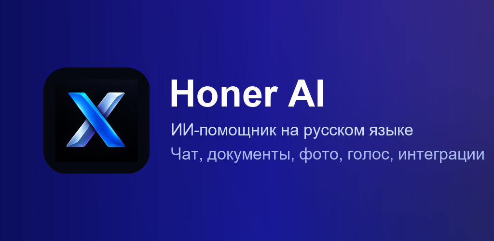
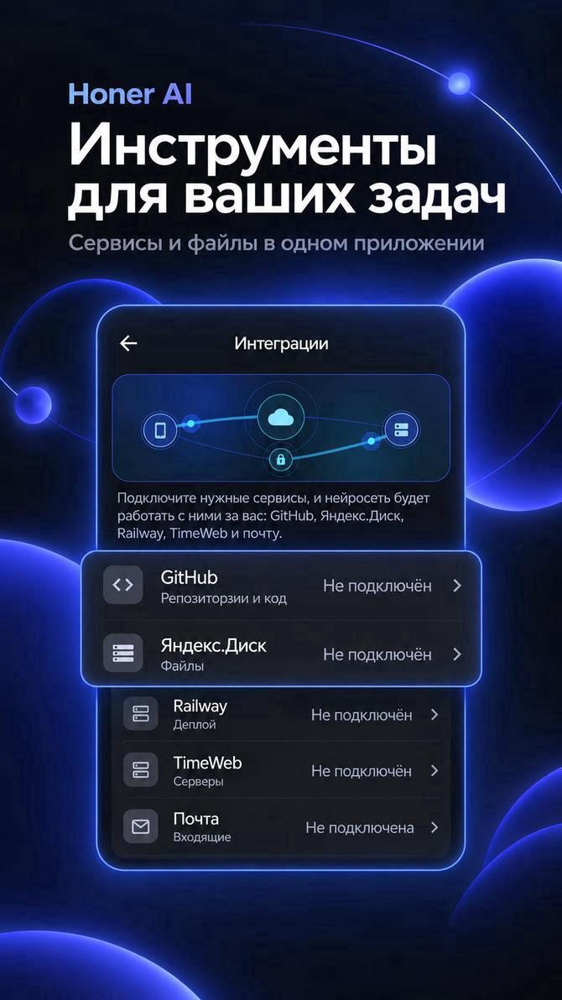
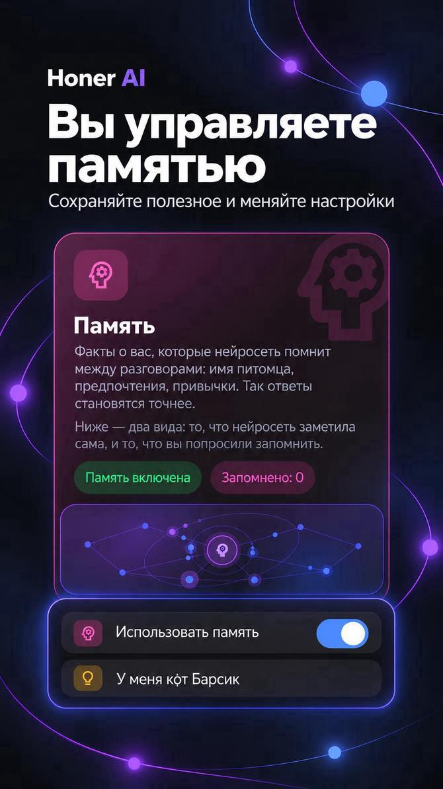
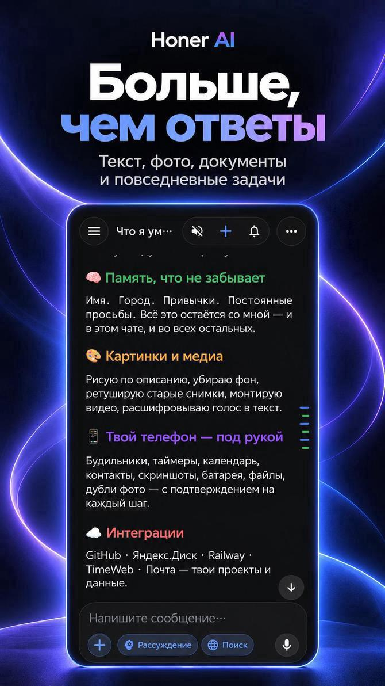
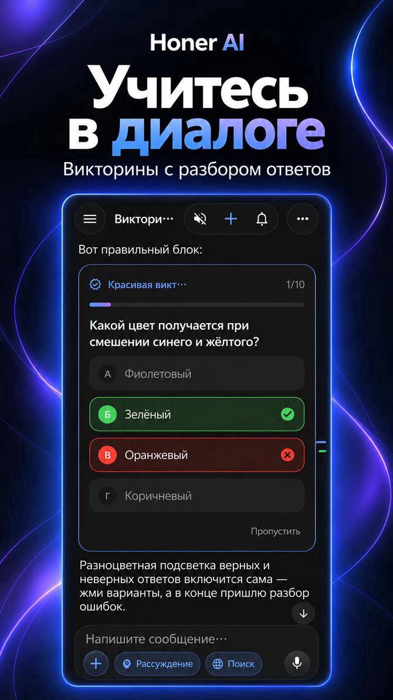
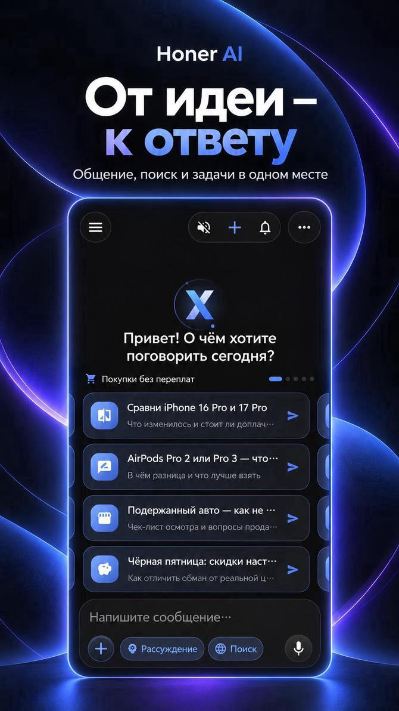
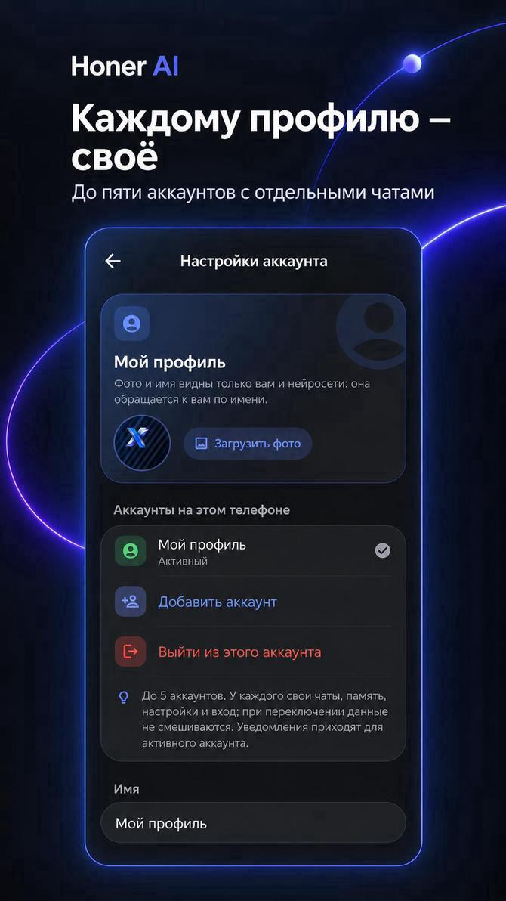
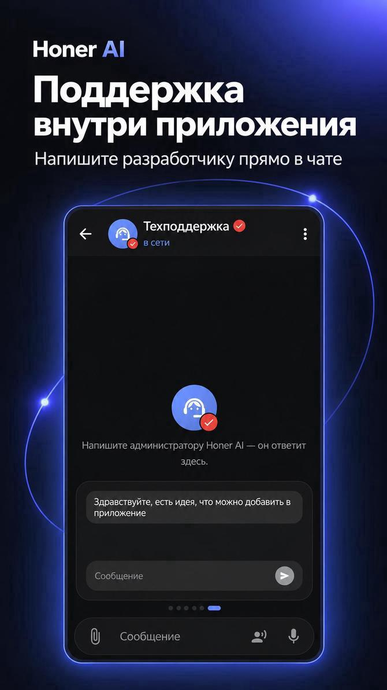

  

<h1 align="center">Honer AI — ИИ-помощник на русском для Android</h1>

<b>ИИ-помощник на русском языке для Android</b> 
Чат с нейросетью · документы и фото · генерация картинок · голос · интеграции с GitHub, Яндекс.Диском и почтой

  
  
  

> **Honer AI** — бесплатное для скачивания приложение для Android с нейросетью на русском языке: чат, генерация картинок, документы и фото, голосовой ввод, поиск в интернете, интеграции с GitHub, Яндекс.Диском и почтой. Девять языков интерфейса. Требуется Android 7.0 или новее.
> *Honer AI is an Android AI assistant app in Russian and eight more languages: chat, image generation, documents and photos, voice, web search and service integrations. The app is free to download; AI responses require internet access.*

🌐 **Официальный сайт:** https://xoner4.github.io/ · 📥 **[Все способы установки](https://xoner4.github.io/download/)**

[APK на GitHub](https://github.com/XONER4/honer-ai/releases/latest) · [Appteka](https://appteka.store/apps/ea1r334201) · [RuStore](https://www.rustore.ru/catalog/app/com.honerai.app)

Версии в магазинах и на сервере загрузки могут обновляться в разное время. Сведения о текущем выпуске APK смотрите на странице релизов; условия доступа к отдельным функциям — внутри приложения.

## Инструкции, готовые запросы и видео

Найдите задачу, посмотрите пример и перейдите к установке приложения. На каждой странице есть ссылки на главную Honer AI и скачивание.

| Раздел | Что внутри |
|---|---|
| [Практические инструкции](https://xoner4.github.io/guides/) | Письма, редактирование текста, учёба, таблицы, изображения, память, планы и публичные репозитории GitHub |
| [Готовые запросы](https://xoner4.github.io/prompts/) | Шаблоны для повседневных задач, которые можно скопировать и адаптировать |
| [Видеодемонстрации](https://xoner4.github.io/videos/) | Интерфейс приложения, примеры работы и пояснения к возможностям |
| [Обзор возможностей](https://xoner4.github.io/features/) | Чат, поиск, изображения, файлы, память и доступные подключения |
| [Помощь и поддержка](https://xoner4.github.io/help/) | Установка, обновление, настройка и обращение в поддержку |

Примеры в инструкциях помогают сформулировать задачу. Проверяйте важные сведения, расчёты и содержание готовых файлов перед использованием.

## Что умеет Honer AI

| | |
|---|---|
| 💬 **Умный чат** | Вопросы, идеи, объяснение сложных тем, перевод и планы. История, поиск по чатам, избранное, черновики |
| 🎨 **Генерация картинок** | Опишите, что хотите увидеть, и получите готовое изображение в чате |
| 📎 **Документы и фото** | Файлы, PDF и до 15 фото за раз; таблицы, диаграммы и файлы создаются на лету |
| 🌐 **Поиск в интернете** | Нейросеть ищет, читает страницы и даёт ссылки на источники |
| 🎙 **Голос** | Говорите вместо печати и слушайте ответы |
| 🧠 **Память** | Сохранение полезных фактов и предпочтений; просмотр и управление записями в настройках |
| 🛠 **Помощник по приложению** | Подскажет, где настройка, покажет кнопку и поменяет её по вашей просьбе |
| 🎮 **Игры и викторины** | Шахматы, шашки, «Дурак» без денежных ставок |
| 🔒 **Защита** | PIN-код и замок чатов, удаление аккаунта и данных в приложении |

## Скриншоты

     

     

## Интеграции с вашими сервисами

**GitHub** · **Яндекс.Диск** · **Railway** · **Timeweb Cloud** · **Почта (IMAP, только чтение)**

Подключения настраиваются в приложении. Доступные действия зависят от версии приложения, выбранного сервиса и выданных прав. Публичный репозиторий GitHub можно использовать как источник для запроса; доступ к личным материалам требует подходящего подключения. Перед изменениями в подключённом сервисе проверяйте описание действия и запрашиваемое подтверждение. С крупными материалами работайте по частям и проверяйте полноту прочитанного.

## Девять языков

🇷🇺 Русский · 🇬🇧 English · 🇪🇸 Español · 🇫🇷 Français · 🇵🇹 Português · 🇸🇦 العربية · 🇨🇳 中文 · 🇮🇳 हिन्दी · 🇧🇩 বাংলা

## Частые вопросы

<b>Сколько это стоит?</b>

Приложение бесплатно для скачивания. Ответы ИИ обрабатываются на сервере приложения и у внешних поставщиков ИИ, поэтому нужен интернет.

<b>Нужна ли регистрация?</b>

Для начала общения сторонний аккаунт не нужен. Доступные способы входа и облачную копию можно настроить в приложении. Перед сменой телефона проверьте, что нужные данные сохранены и доступны для восстановления.

<b>Какие версии Android поддерживаются?</b>

Android 7.0 и новее.

<b>Как обновить приложение?</b>

Проверьте обновление в магазине, из которого установлено приложение, или используйте официальный APK из GitHub Releases. При обычном обновлении совместимой подписанной сборки Android сохраняет данные. Если предлагается удаление или возникла ошибка подписи, обратитесь в поддержку до удаления приложения. [Способы установки и обновления](https://xoner4.github.io/download/).

<b>Что с моими данными?</b>

Чаты хранятся на вашем телефоне; облачная копия включается по желанию. Аккаунт и данные можно удалить в приложении. Подробности — в [политике конфиденциальности](https://xoner4-honor-pk-agent-ios-57fa.twc1.net/legal/privacy). Нейросеть может ошибаться — важные сведения проверяйте.

## Скачать

**[⬇ Honer AI 10.61.4 в Appteka](https://appteka.store/apps/ea1r334201)** · **[APK на GitHub (релизы)](https://github.com/XONER4/honer-ai/releases/latest)** · пакет `com.honerai.app`

[Политика конфиденциальности](https://xoner4-honor-pk-agent-ios-57fa.twc1.net/legal/privacy) · [Пользовательское соглашение](https://xoner4-honor-pk-agent-ios-57fa.twc1.net/legal/terms) · Поддержка: helper2026ai@mail.ru

© Honer AI. Разработчик: HONER. Исходный код приложения не распространяется.
